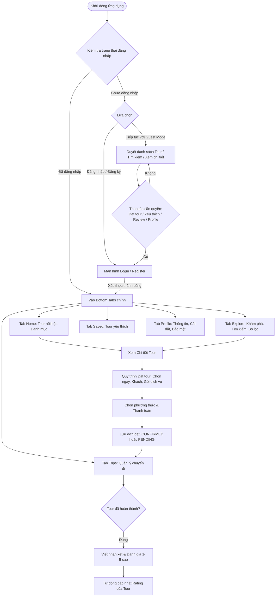
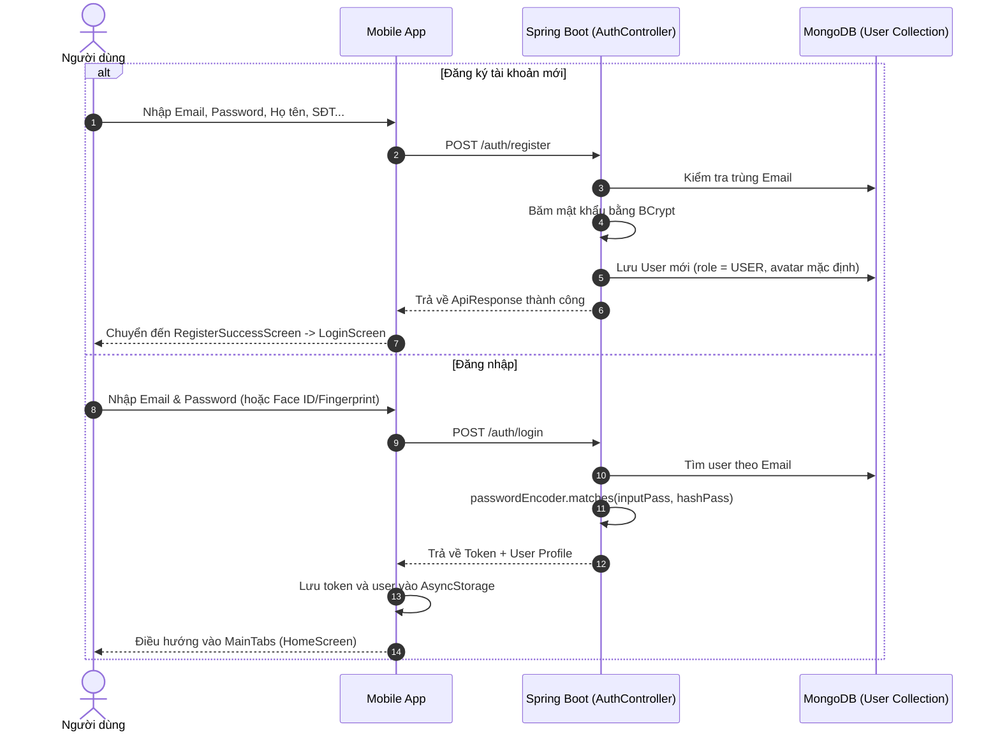
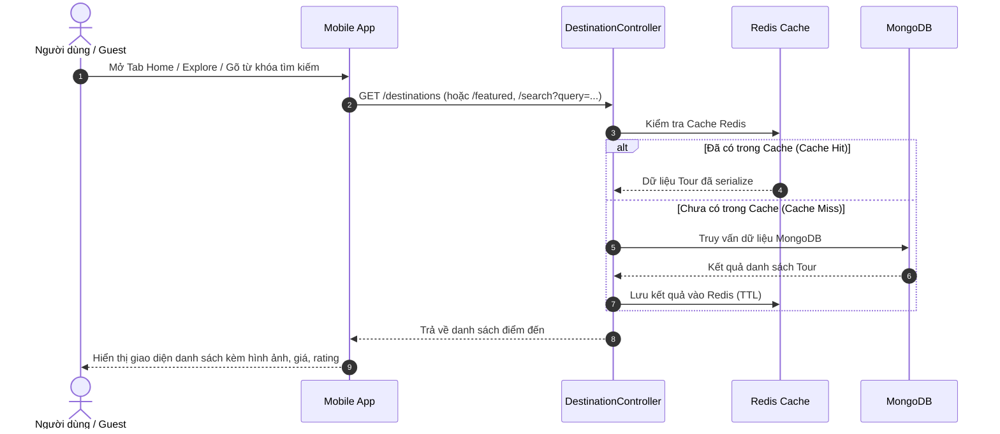
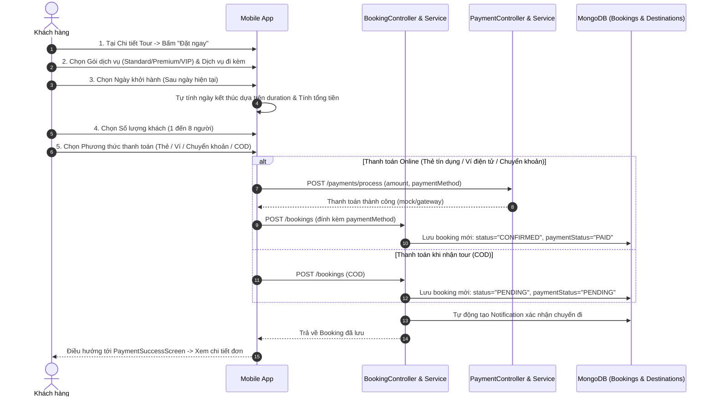
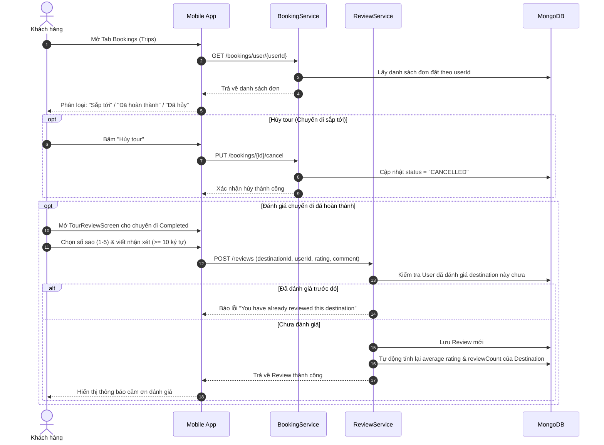
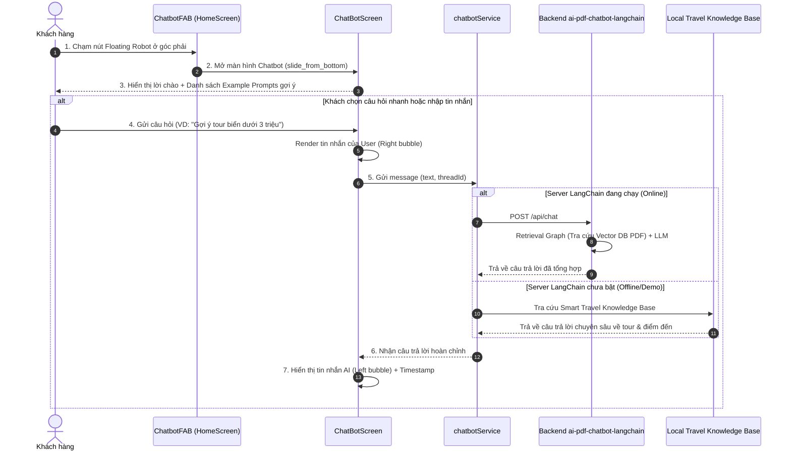
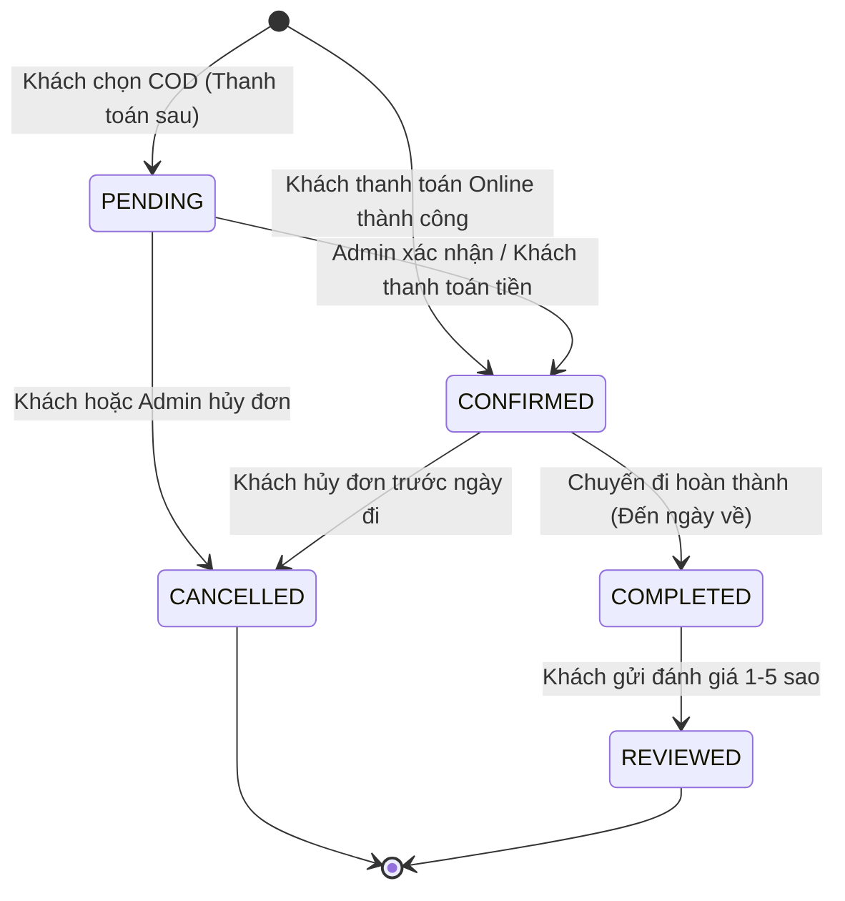

# 🧭 TÀI LIỆU WORKFLOW HỆ THỐNG TRAVELLING-APP

> **Phiên bản:** 1.0  
> **Dự án:** Travelling-App (Ứng dụng du lịch di động)  
> **Tech Stack:** React Native (Expo) + Spring Boot 3.x + MongoDB Atlas + Redis Cache  

---

## 📌 MỤC LỤC
1. [Tổng Quan Kiến Trúc Hệ Thống](#1-tổng-quan-kiến-trúc-hệ-thống)
2. [Phân Tích Tác Nhân & Chức Năng Của Admin](#2-phân-tích-tác-nhân--chức-năng-của-admin)
3. [Sơ Đồ Luồng Hoạt Động Tổng Thể (Master Workflow)](#3-sơ-đồ-luồng-hoạt-động-tổng-thể-master-workflow)
4. [Chi Tiết Các Workflow Nghiệp Vụ](#4-chi-tiết-các-workflow-nghiệp-vụ)
   - [4.1. Workflow Xác Thực & Quản Lý Tài Khoản](#41-workflow-xác-thực--quản-lý-tài-khoản)
   - [4.2. Workflow Khám Phá & Tìm Kiếm Tour](#42-workflow-khám-phá--tìm-kiếm-tour)
   - [4.3. Workflow Đặt Tour & Thanh Toán (Cốt Lõi)](#43-workflow-đặt-tour--thanh-toán-cốt-lõi)
   - [4.4. Workflow Quản Lý Chuyến Đi & Đánh Giá](#44-workflow-quản-lý-chuyến-đi--đánh-giá)
   - [4.5. Workflow Quản Trị Viên (Admin)](#45-workflow-quản-trị-viên-admin)
   - [4.6. Workflow Trợ Lý Du Lịch AI Chatbot](#46-workflow-trợ-lý-du-lịch-ai-chatbot)
5. [Quy Trình Chuyển Đổi Trạng Thái Đơn Đặt (State Machine)](#5-quy-trình-chuyển-đổi-trạng-thái-đơn-đặt-state-machine)
6. [Bản Đồ API Endpoints Tương Ứng Với Workflow](#6-bản-đồ-api-endpoints-tương-ứng-với-workflow)

---

## 1. TỔNG QUAN KIẾN TRÚC HỆ THỐNG

Hệ thống hoạt động theo mô hình **Client - Server**:
- **Frontend (Mobile App):** Xây dựng bằng React Native (TypeScript, Expo), React Navigation (Stack & Bottom Tabs), quản lý state qua AuthContext và lưu trữ cục bộ với AsyncStorage.
- **Backend (API Server):** Xây dựng bằng Java Spring Boot 3.x, cung cấp RESTful APIs.
- **Database:** MongoDB Atlas (Cloud) lưu trữ các collections `users`, `destinations`, `bookings`, `reviews`, `notifications`.
- **Caching Layer:** Redis (Docker) dùng để cache các truy vấn phổ biến (Destinations nổi bật, thông tin User) nhằm tối ưu tốc độ phản hồi < 3s.

```
[ Mobile App (React Native/Expo) ]
            │  ▲
   REST API │  │ JSON (Token Auth)
            ▼  │
[ Spring Boot 3.x Backend ]
   ├── Spring Security (BCrypt)
   ├── Service Layer (Booking, Destination, User, Review...)
   ├── Redis Cache (Featured / Popular Destinations)
   └── MongoDB Atlas (Persistent Collections)
```

---

## 2. PHÂN TÍCH TÁC NHÂN & CHỨC NĂNG CỦA ADMIN

Hệ thống phân chia thành **3 Tác nhân (Actors)** chính:
1. **Khách (Guest):** Người chưa đăng nhập hoặc vào app ở chế độ Guest.
2. **Người dùng (User):** Người dùng đã đăng ký/đăng nhập tài khoản.
3. **Quản trị viên (Admin):** Người quản lý hệ thống.

### ❓ Trả lời câu hỏi: Dự án có chức năng của Admin không?

| Tiêu chí | Hiện trạng trong Dự án | Chi tiết phân tích |
| :--- | :---: | :--- |
| **Tài liệu & Thiết kế (SRS / Báo cáo đề tài)** | **CÓ** | Báo cáo đề tài xác định Admin là tác nhân chính với 3 Use Cases cốt lõi:<br>• **UC14 - Quản lý tour:** Thêm, sửa, xóa thông tin tour/điểm đến.<br>• **UC15 - Quản lý người dùng:** Tra cứu, quản lý tài khoản người dùng.<br>• **UC16 - Quản lý đơn đặt:** Xem toàn bộ đơn, duyệt hoặc hủy đơn của khách.<br>• Báo cáo doanh thu & thống kê số lượng đặt tour. |
| **Cơ sở dữ liệu & Model Backend** | **CÓ KHUNG** | Entity `User.java` đã có sẵn trường `role` (mặc định là `"USER"` và hỗ trợ `"ADMIN"`). |
| **API Backend (Spring Boot)** | **MỘT PHẦN** | Backend đã có các API phục vụ nghiệp vụ Admin:<br>• `POST /destinations` (Tạo tour mới)<br>• `PUT /bookings/{id}/status` (Đổi trạng thái đơn)<br>• `PUT /bookings/{id}/payment` (Cập nhật trạng thái thanh toán)<br>• `GET /auth/user/{id}` (Lấy thông tin người dùng)<br>*Lưu ý:* `SecurityConfig` hiện đang để `permitAll()` để test, chưa kích hoạt `@PreAuthorize("hasRole('ADMIN')")`. |
| **Giao diện Frontend (React Native Mobile)** | **CHƯA CÓ UI RIÊNG** | Ứng dụng hiện tại là Mobile App dành riêng cho **End-User (Khách hàng)**.<br>Nút `admin / admin12345` ở màn hình Login chỉ là tài khoản test nhanh, khi đăng nhập sẽ load `mockAdminUser` với giao diện như một User thông thường. Chưa có Dashboard quản trị trên app hoặc Web Admin Portal. |

---

## 3. SƠ ĐỒ LUỒNG HOẠT ĐỘNG TỔNG THỂ (MASTER WORKFLOW)



---

## 4. CHI TIẾT CÁC WORKFLOW NGHIỆP VỤ

### 4.1. Workflow Xác Thực & Quản Lý Tài Khoản



#### Quy tắc nghiệp vụ:
- Mật khẩu lưu dưới dạng hash BCrypt (salt = 10 rounds), không lưu plain text.
- Chế độ **Guest Mode**: Được duyệt tour, xem ảnh, đọc đánh giá; bị chặn khi đặt tour, thêm yêu thích hoặc đánh giá.
- Hỗ trợ đăng nhập sinh trắc học (**Fingerprint / Face ID**) thông qua lưu credential an toàn.

---

### 4.2. Workflow Khám Phá & Tìm Kiếm Tour



#### Quy tắc nghiệp vụ:
- Danh mục tour: *Beach (Biển), Nature (Thiên nhiên), Cultural (Văn hóa), Entertainment (Giải trí), Luxury (Cao cấp)*.
- Lọc nâng cao theo: Tầm giá `min - max`, số sao tối thiểu, thời lượng chuyến đi (`duration`).
- Màn hình chi tiết tour hỗ trợ Parallax Header, danh sách ảnh Unsplash, danh sách tiện ích (`WiFi`, `Bữa sáng`, `Đưa đón sân bay`, `Hướng dẫn viên`).

---

### 4.3. Workflow Đặt Tour & Thanh Toán (Cốt Lõi)



#### Quy tắc nghiệp vụ:
- **Xác thực ngày đi:** Ngày khởi hành phải lớn hơn thời điểm hiện tại.
- **Tính toán ngày về:** Dựa vào `duration` của điểm đến (ví dụ tour "5 days" $\rightarrow$ ngày về = ngày đi + 5 ngày).
- **Trạng thái đơn hàng khởi tạo:**
  - Online payment: `CONFIRMED` + `PAID`.
  - Cash on delivery (COD): `PENDING` + `PENDING`.
- **Thông báo:** Kích hoạt tạo bản ghi trong collection `notifications` thông báo lịch trình cho tài khoản đặt tour.

---

### 4.4. Workflow Quản Lý Chuyến Đi & Đánh Giá



#### Quy tắc nghiệp vụ:
- **Chống spam đánh giá:** Mỗi tài khoản chỉ được để lại **1 đánh giá duy nhất** cho mỗi điểm đến du lịch.
- **Cập nhật Rating Real-time:** Khi có review mới hoặc cập nhật review, Backend tự động tổng hợp lại điểm trung bình (`destination.rating`) và số lượt đánh giá (`destination.reviewCount`).

---

### 4.5. Workflow Quản Trị Viên (Admin)

Mặc dù UI Mobile hiện tại chưa tích hợp bảng điều khiển riêng cho Admin, quy trình nghiệp vụ Admin theo thiết kế hệ thống bao gồm:

```mermaid
flowchart TD
    AdminLogin([Admin Đăng nhập với quyền ADMIN]) --> AdminDashboard[Trang Quản Trị Hệ Thống]
    
    %% Quản lý Tour
    AdminDashboard --> ManageTours[Quản lý Điểm Đến / Tours]
    ManageTours --> CreateTour[POST /destinations: Tạo Tour mới]
    ManageTours --> UpdateTour[PUT /destinations/{id}: Sửa nội dung, hình ảnh, giá]
    ManageTours --> DeleteTour[DELETE /destinations/{id}: Xóa hoặc ẩn tour]
    
    %% Quản lý Đơn đặt
    AdminDashboard --> ManageBookings[Quản lý Đơn Đặt Chỗ]
    ManageBookings --> ViewAllBookings[Xem toàn bộ danh sách đơn đặt trên hệ thống]
    ManageBookings --> ApproveBooking[PUT /bookings/{id}/status: Duyệt đơn PENDING -> CONFIRMED]
    ManageBookings --> CancelBooking[PUT /bookings/{id}/status: Hủy đơn nếu có sự cố]
    
    %% Quản lý Người dùng
    AdminDashboard --> ManageUsers[Quản lý Người Dùng]
    ManageUsers --> ViewUsers[GET /auth/user: Tra cứu thông tin khách hàng]
    ManageUsers --> BanUser[Khóa hoặc cập nhật thông tin tài khoản vi phạm]
```

### 4.6. Workflow Trợ Lý Du Lịch AI Chatbot (Tích hợp RAG từ ai-pdf-chatbot-langchain)



---

## 5. QUY TRÌNH CHUYỂN ĐỔI TRẠNG THÁI ĐƠN ĐẶT (STATE MACHINE)



---

## 6. BẢN ĐỒ API ENDPOINTS TƯƠNG ỨNG VỚI WORKFLOW

| Phân hệ / Workflow | Phương thức | Endpoint | Chức năng | Phân quyền |
| :--- | :---: | :--- | :--- | :---: |
| **Xác thực (Auth)** | `POST` | `/auth/register` | Đăng ký tài khoản mới | Public |
| | `POST` | `/auth/login` | Đăng nhập tài khoản | Public |
| | `GET` | `/auth/user/{id}` | Lấy thông tin cá nhân | Authenticated |
| | `PUT` | `/auth/user/{id}` | Cập nhật hồ sơ cá nhân | Authenticated |
| | `PUT` | `/auth/user/{id}/password` | Đổi mật khẩu | Authenticated |
| **Điểm đến (Destinations)** | `GET` | `/destinations` | Lấy tất cả điểm đến | Public |
| | `GET` | `/destinations/{id}` | Xem chi tiết 1 điểm đến | Public |
| | `GET` | `/destinations/featured` | Điểm đến nổi bật (có Redis cache) | Public |
| | `GET` | `/destinations/popular` | Điểm đến phổ biến (có Redis cache) | Public |
| | `GET` | `/destinations/search?query=` | Tìm kiếm điểm đến theo từ khóa | Public |
| | `GET` | `/destinations/category/{cat}` | Lọc theo danh mục | Public |
| | `POST` | `/destinations` | Tạo mới điểm đến | **Admin** |
| **Đặt chỗ (Bookings)** | `POST` | `/bookings` | Tạo mới đơn đặt tour | Authenticated |
| | `GET` | `/bookings/{id}` | Xem chi tiết đơn đặt | Authenticated |
| | `GET` | `/bookings/user/{userId}` | Danh sách đơn của người dùng | Authenticated |
| | `GET` | `/bookings/user/{userId}/upcoming` | Đơn sắp tới | Authenticated |
| | `GET` | `/bookings/user/{userId}/completed`| Đơn đã hoàn thành | Authenticated |
| | `PUT` | `/bookings/{id}/status` | Đổi trạng thái (`CONFIRMED`, `CANCELLED`...) | **Admin / User** |
| | `PUT` | `/bookings/{id}/payment` | Cập nhật trạng thái thanh toán | **Admin / User** |
| | `PUT` | `/bookings/{id}/cancel` | Hủy đơn đặt | Authenticated |
| **Thanh toán (Payments)** | `POST` | `/payments/process` | Xử lý thanh toán thẻ/ví điện tử | Authenticated |
| **Đánh giá (Reviews)** | `POST` | `/reviews` | Viết đánh giá cho tour đã hoàn thành | Authenticated |
| | `GET` | `/reviews/destination/{id}` | Xem toàn bộ đánh giá của 1 tour | Public |
| | `GET` | `/reviews/user/{userId}` | Xem các đánh giá của người dùng | Authenticated |
| **Yêu thích (Favorites)** | `POST` | `/favorites/toggle` | Thêm/Xóa tour khỏi danh sách yêu thích | Authenticated |
| | `GET` | `/favorites/user/{userId}` | Lấy danh sách tour yêu thích | Authenticated |
| **Thông báo (Notifications)**| `GET` | `/notifications/{userId}` | Lấy thông báo của người dùng | Authenticated |
| | `PUT` | `/notifications/{id}/read` | Đánh dấu thông báo đã đọc | Authenticated |
| | `GET` | `/notifications/{userId}/unread-count` | Số lượng thông báo chưa đọc | Authenticated |

---

## 7. GỢI Ý ĐỂ HOÀN THIỆN ĐẦY ĐỦ CHỨC NĂNG ADMIN
Để dự án hoàn thiện 100% chức năng Admin cả về Backend và Giao diện:
1. **Hoàn thiện RBAC Backend:**
   - Kích hoạt phân quyền trong `SecurityConfig.java`: Phân chia URL `requestMatchers("/admin/**").hasRole("ADMIN")`.
   - Sinh JWT Token thực thụ chứa Claim `role: "ADMIN"`.
2. **Xây dựng Giao diện Admin:**
   - Khuyến nghị xây dựng một **Web Admin Portal riêng** (bằng ReactJS / Next.js hoặc tích hợp màn hình Admin riêng trên Mobile dành riêng cho tài khoản có `role === 'ADMIN'`).
   - Màn hình gồm: Thống kê doanh thu, Bảng duyệt đơn đặt tour, Bảng thêm/sửa/xóa Tour du lịch.
